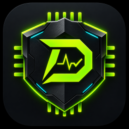
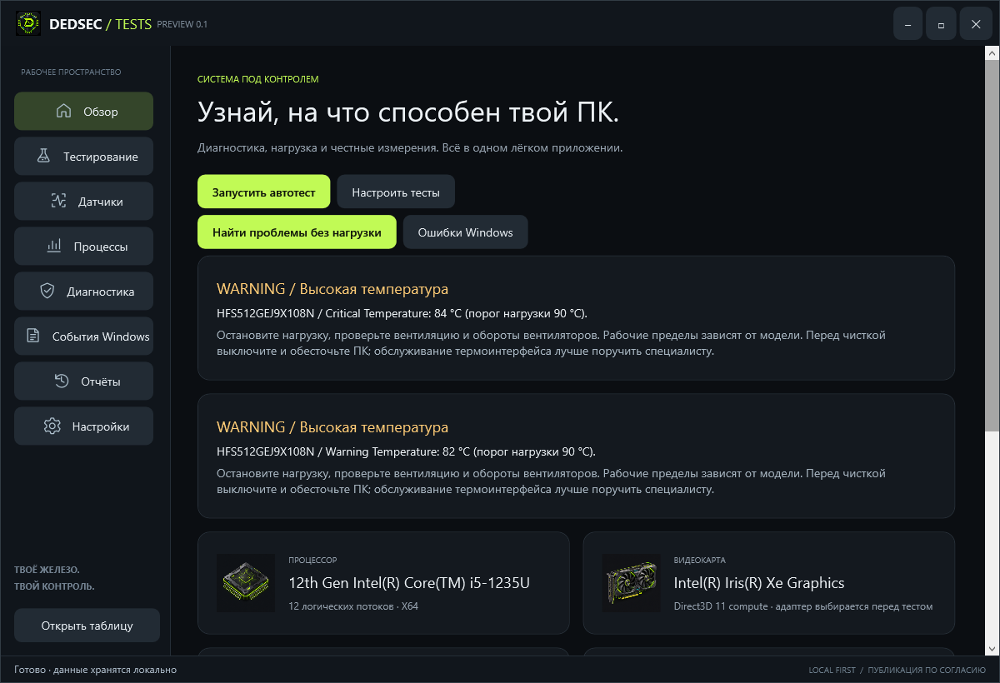
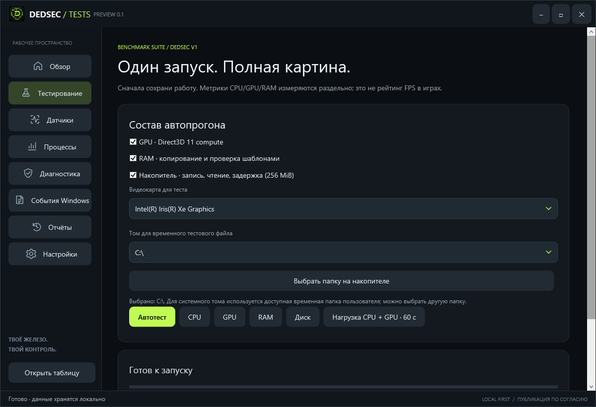
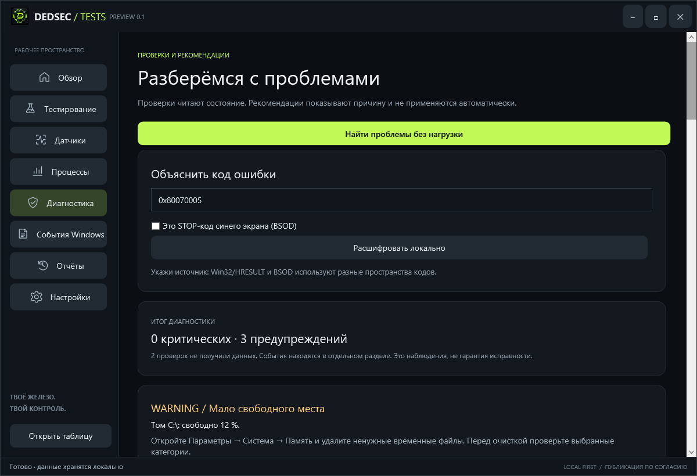
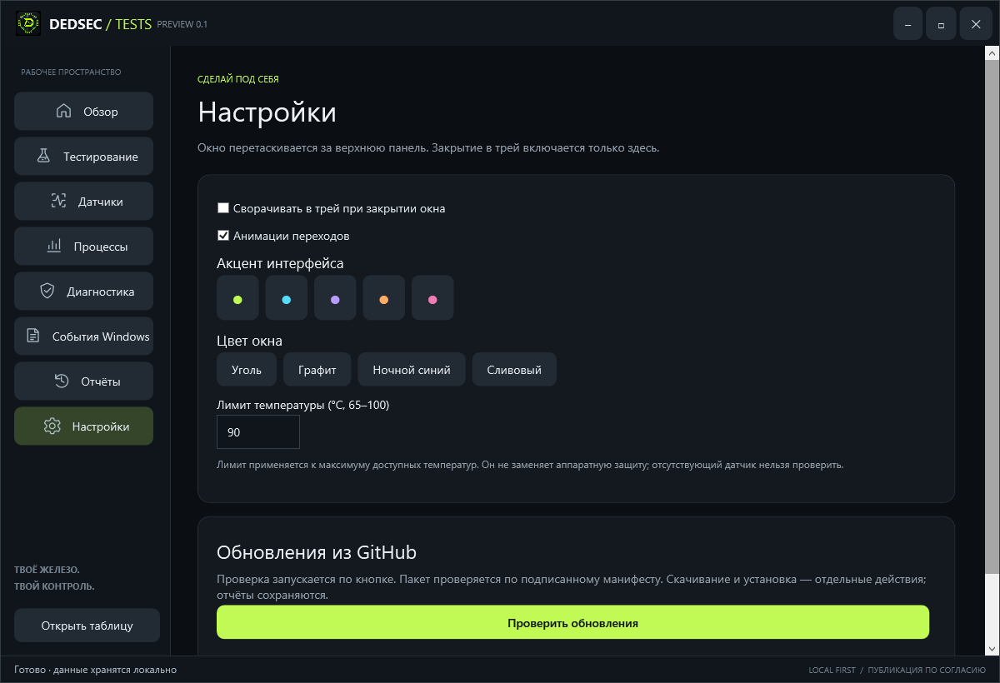

<div align="center">


# DEDSEC / TESTS

**Твоё железо. Твой контроль.**

Диагностика Windows с объяснениями, мониторинг и собственные бенчмарки.<br>Нативное приложение. Публикация только по твоему решению.

[](https://github.com/Dedseckms/Dedsec-Tests/actions/workflows/ci.yml)
[](https://github.com/Dedseckms/Dedsec-Tests/releases)
[](LICENSE)
[](https://github.com/Dedseckms/Dedsec-Tests/releases)

[**Скачать приложение**](https://github.com/Dedseckms/Dedsec-Tests/releases) · [**Открытая таблица**](https://tests.dedseckms.ru) · [Методика](https://tests.dedseckms.ru/methodology) · [Сообщить об ошибке](https://github.com/Dedseckms/Dedsec-Tests/issues)


</div>

## Не просто цифра после теста

Dedsec Tests помогает понять, **что произошло, насколько это определённо и что проверять дальше**. Программа не отключает защиту, не меняет реестр ради «оптимизации» и не обещает найти каждую неисправность.

| Возможность | Что показывает |
|---|---|
| Диагностика без нагрузки | Память, файл подкачки, свободное место, обновления, ожидающая перезагрузка, PnP, автозагрузка, защита и отдельные сетевые/питающие показатели |
| Понятные события Windows | System/Application за 7 дней; группировка, время, количество, объяснение источника + Event ID и следующий шаг |
| Аппаратные симптомы | WHEA, внезапное выключение, ошибки ввода-вывода, NTFS, сбросы видеодрайвера, нехватка ресурсов |
| Датчики | Доступные температуры, частоты, загрузка, мощность, вентиляторы и показатели памяти — по поддержке LibreHardwareMonitor |
| Текущие проблемы | Высокая температура, почти полная загрузка ресурса, давление на RAM, процессы с заметной нагрузкой |
| CPU | Отдельный single/multi SHA-256 benchmark |
| GPU | Выбор адаптера, Direct3D 11 integer compute, проверка результата на CPU, отдельный рабочий процесс и таймаут |
| RAM | Пропускная способность копирования и до 256 MiB адресных шаблонов проверки |
| HDD / SSD / USB | Выбранный том/папка, временный файл 256 MiB, некэшируемое чтение/запись, проверка данных, случайная задержка |
| Нагрузка | 60 секунд CPU + выбранного GPU, отмена, наблюдение за температурами |
| Накопители и питание | Ограниченный ATA SMART, доступные Storage Reliability counters, состояние/ёмкость батареи при доступном WMI |
| Отчёты | Локальная история, JSON, HTML, отдельное согласие на публикацию и удаление своей записи ключом |
| Интерфейс | Собственные иконки, анимации, акцент и цвет окна, перетаскивание, переключатель трея |
| Обновления | GitHub Releases, подпись манифеста RSA-PSS, SHA-256, установка по кнопке и откат |

Например, **Kernel-Power 41 не объявляется «сломавшимся БП»**: программа объясняет, что это запись о нештатном выключении, и предлагает сопоставить её с BugCheck/WHEA, питанием, нагревом и реальными обстоятельствами. Недоступный датчик или журнал получает статус «неизвестно», а не зелёную галочку.

## Как начать

1. В [Releases](https://github.com/Dedseckms/Dedsec-Tests/releases) выберите **Setup-x64** для обычной 64-битной Windows или **Setup-x86** для 32-битной. Portable ZIP достаточно распаковать в отдельную доступную для записи папку.
2. Прочитайте лицензию и условия. Установка выполняется для текущего пользователя; отдельная установка .NET не нужна — runtime включён.
3. Начните с **«Найти проблемы без нагрузки»**. Для измерений сохраните работу и запустите автотест или нужный компонент.
4. Прочитайте отчёт и рекомендации. Отправлять результат необязательно. Перед публикацией приложение покажет отправляемый JSON.
5. Если публикация разрешена, появятся кнопки **«Открыть результат»** и **«Удалить с сайта»**. Локальный JSON содержит секретный ключ удаления — не размещайте его публично.

Установщик оформлен в тёмной теме Dedsec и показывает [лицензию и соглашение](LICENSE-RU.txt) перед установкой. Нагрузка и публикация требуют отдельных согласий в приложении.

<details><summary><b>Ещё скриншоты</b></summary>

### Выбор тестов


### Диагностика и расшифровка кодов


### Настройки и обновления

</details>

## Анонимная таблица

[tests.dedseckms.ru](https://tests.dedseckms.ru) показывает модели компонентов, объёмы RAM/дисков, Windows, отдельные метрики и версии методики. Есть поиск, сортировка, сравнение до трёх записей и постоянная ссылка. На телефонах результаты превращаются в карточки. Сайт обновляет таблицу раз в 30 секунд без перезагрузки страницы.

Не публикуются имя пользователя/ПК, серийные номера, MAC, процессы, пути, локальные события и рекомендации. IP не входит в отчёт и не сохраняется сервисом результатов в базе или access logs; сервер технически видит соединение и использует временный ограничитель запросов в памяти. Редкая конфигурация может быть узнаваема. [Полная политика](https://tests.dedseckms.ru/privacy).

Результаты **предоставлены клиентом и не верифицированы независимо**. Не сравнивайте разные методики. GPU compute — не игровой FPS; CPU SHA-256 — не универсальная оценка производительности; ноль ошибок небольшой выделенной RAM не означает, что исправна вся память. [Подробная методика](https://tests.dedseckms.ru/methodology).

## Совместимость и честные ограничения

Цель — Windows 10 1607+ / Windows 11, x64 и x86, включая компьютеры без AVX2. Фактически текущая сборка проверена на Windows 11 x64, включая запуск x86-версии. Физические старые ПК, Windows 10 и все модели AMD/NVIDIA/Intel ещё требуют пользовательской проверки. Срок поддержки самой Windows определяется Microsoft отдельно от запуска приложения.

- Для GPU benchmark нужен аппаратный Direct3D 11 feature level 11.0. Другие проверки работают независимо; программный адаптер пропускается.
- Для части CPU-датчиков нужны права администратора и установленный отдельно [PawnIO](https://pawnio.eu/). Драйвер не устанавливается скрыто. Поддержка конкретного сенсора зависит от LibreHardwareMonitor.
- Температурная остановка работает при доступных датчиках; при исчезновении ранее доступных показаний или зависании мониторинга тест отменяется. Аппаратная защита остаётся необходимой.
- Не весь SMART доступен через Windows, особенно на NVMe/RAID/USB. Отсутствующие показатели не считаются нулевыми.
- Приложение не заменяет полноценный загрузочный тест RAM, анализ дампа в WinDbg, антивирус и физическую сервисную диагностику.
- Начальный EXE/Setup пока без Authenticode-подписи издателя. Подпись манифеста обновления — отдельный механизм, она не заменяет Authenticode.

## Сборка и проверка

Требуются Windows, .NET SDK 10 и Inno Setup 6.7+ для установщиков.

```powershell
dotnet run --project tests/Dedsec.Tests.Checks -c Release
dotnet run --project tests/Dedsec.Tests.Checks -c Release -- --hardware
python -m unittest discover -s server -p "test_*.py" -v
node --check server/web/app.js
./scripts/Build.ps1 -Dotnet dotnet -Iscc 'C:\Program Files (x86)\Inno Setup 6\ISCC.exe'
```

`--hardware` выполняет настоящие CPU/RAM/GPU/дисковые проверки на текущем ПК, включая запись временного файла. Не используйте этот режим на неисправном накопителе без резервной копии. Синтетические API fixtures используются только в тестах и удаляются из публичной таблицы.

Архитектура: C#/WPF, LibreHardwareMonitor, Vortice.Direct3D11; сервер — Python stdlib + SQLite; сайт — HTML/CSS/JS без сборщика и аналитики. [Развёртывание и обновления](docs/OPERATIONS.md) · [Методика и источники объяснений](docs/METHODOLOGY.md) · [Проверки выпуска](docs/VALIDATION.md).

## Лицензия

[MIT](LICENSE). [Русские условия использования](LICENSE-RU.txt), [сторонние компоненты](THIRD-PARTY-NOTICES.md), [сообщения о безопасности](SECURITY.md). Иконки и оформление созданы специально для Dedsec Tests; [описание генерации](docs/DESIGN.md).
